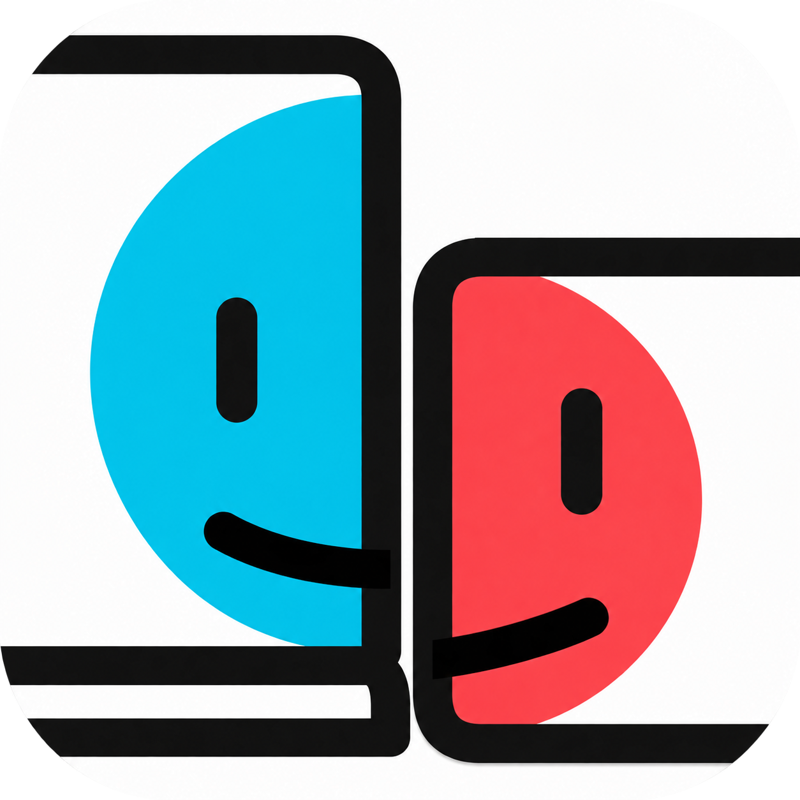

<p align="center">
  
</p>

<h1 align="center">OpenDisplay NX</h1>

<p align="center">Turn your Nintendo Switch into a second display for your Mac.</p>

<p align="center">
  <a href="https://github.com/IlieBanda/OpenDisplay-NX/releases/latest">Download</a> ·
  <a href="#quick-start">Quick start</a> ·
  <a href="#controls">Controls</a> ·
  <a href="docs/PERFORMANCE.md">Performance</a> ·
  <a href="https://github.com/IlieBanda/OpenDisplay-NX/issues">Report an issue</a>
</p>

OpenDisplay NX is a free, open-source homebrew receiver for Nintendo Switch (V1/V2), Switch Lite and Switch OLED. Connect over Wi-Fi and use the console as an extra screen for your Mac with the [OpenDisplay sender](https://github.com/peetzweg/opendisplay).

Works directly with the [official OpenDisplay Sender for Mac](https://github.com/peetzweg/opendisplay/releases/latest) through the native OpenDisplay protocol. No modified sender or additional bridge is needed. Select your Switch from the sender’s device list to connect.

## Features

- **720p video.** H.264 hardware decoding through Tegra NVDEC, with software fallback.
- **Touch input.** Control the Mac pointer from the Switch screen, with the sender's cursor displayed on the receiver.
- **A familiar interface.** Switch-style menus, console system fonts, native button symbols and light/dark themes.
- **Four languages.** English, Russian, Spanish and Simplified Chinese, with your choice saved between launches.
- **Uninterrupted viewing.** The screen stays awake while connected. HOME keeps the session running; fully closing the application disconnects the Mac.
- **Optional statistics.** View FPS and estimated delay from the menu when you need them.

## Quick start

1. Download [OpenDisplay NX v0.1.0](https://github.com/IlieBanda/OpenDisplay-NX/releases/latest) and extract the installation ZIP to the root of your SD card.
2. Hold **R** while launching a game to open Homebrew Menu with full application memory, then launch **OpenDisplay NX**.
3. Connect your Switch and Mac to the same Wi-Fi network. **5 GHz** is recommended.
4. Open the [OpenDisplay Mac sender](https://github.com/peetzweg/opendisplay/releases/latest), select your Switch from the device list and start with **Fast** quality.

For a manual installation, place `opendisplay-nx.nro` in `sd:/switch/opendisplay-nx/`. Homebrew Menu launched from the Album does not provide the required application memory.

## Controls

Press **+** to open the menu during playback. Decoder mode, statistics, language, Disconnect and Exit are available there.

| Input | Action |
|---|---|
| + | Open or close the menu |
| Either stick or D-pad | Select a menu item |
| A | Confirm |
| B | Return to video |
| Touch | Control the Mac pointer or select menu items |

## Compatibility

The receiver targets the original Nintendo Switch family: **Switch V1/V2, Switch Lite and Switch OLED**. It does not require an OLED panel or detachable Joy-Con. All three model families use a 1280 × 720 handheld display ([Nintendo comparison](https://www.nintendo.com/en-gb/Hardware/Nintendo-Switch-Family/Which-Nintendo-Switch-is-right-for-you-/Which-Nintendo-Switch-is-right-for-you-1596110.html)).

| Model | Validation status |
|---|---|
| Switch OLED | Tested on hardware |
| Switch V1/V2 | Expected to work; not yet tested on hardware |
| Switch Lite | Expected to work; not yet tested on hardware |

A console capable of running homebrew with full application memory is required. Performance on V1/V2 and Lite still needs device testing.

The receiver uses Wi-Fi IPv4 and the OpenDisplay v3 protocol. It advertises a 1280 × 720 display and supports up to 60 FPS with hardware decoding, or up to 30 FPS with software decoding. Actual frame rate and delay depend on the sender and network.

Audio stays on the Mac, so you can keep using its speakers or connected headphones. USB, HEVC, rotation and controller mouse input are not supported yet. Docked mode currently uses the same 720p layout as handheld mode.

This first release was tested on Switch OLED, including extended video playback and HOME return. Continuous test streams typically sampled 57–60 FPS, although a network latency spike occurred in one run. See [performance notes](docs/PERFORMANCE.md) for measurements and test conditions. Use a trusted local network; the transport does not authenticate peers.

## Build

Install devkitPro with devkitA64, libnx, switch-sdl2 and switch-libpng.

```sh
./tools/build.sh
```

The script fetches and builds the pinned `nvtegra` branch of
[Averne's FFmpeg](https://github.com/averne/FFmpeg/tree/nvtegra) with H.264/NVDEC,
then creates `opendisplay-nx.nro`. `DEVKITPRO` defaults to `/opt/devkitpro`.
Set `REBUILD_FFMPEG=1` to force dependency rebuilding; `JOBS` defaults to 8.

Host validation requires a C++17 compiler, libpng, Python 3 and FFmpeg with libx264:

```sh
./tools/test.sh
python3 tools/test_sender.py SWITCH_IP --seconds 30 --fps 60 --bitrate 6M
```

Tests exercise TCP fragmentation/coalescing, size limits, control/video demux,
DNS-SD records, base64 and PNG cursor decoding, and a real framed H.264 test stream.
With host FFmpeg/SDL2 development headers, tests also execute the actual Video
implementation through 30 software sessions, plus 27 actual TCP worker
sessions, including a quality change, delayed UI, UDP cursor ordering,
clock sync, close, and HOME frame retention under ASan/UBSan.
`VIDEO_SANITIZER=thread python3 tests/test_video.py` runs the concurrency checks. They do not execute the Tegra hardware path; that requires a Switch.

## License and credits

Project code: GPL-3.0 (see [LICENSE](LICENSE)). The selected FFmpeg/NVTEGRA build
is GPL-2.0-or-later and is compatible with this distribution under GPL-3.0.
The vendored stb_truetype rasterizer is MIT; the Switch system font is loaded
from console shared memory and is not redistributed. nlohmann/json v3.12.0 is MIT; libpng and zlib retain their own licenses.

- [OpenDisplay](https://github.com/peetzweg/opendisplay): protocol and Mac sender.
- [Averne/FFmpeg](https://github.com/averne/FFmpeg/tree/nvtegra): Tegra hardware backend.
- [Moonlight-Switch](https://github.com/XITRIX/Moonlight-Switch): hardware integration reference.
- [devkitPro/libnx](https://github.com/switchbrew/libnx), SDL2, libpng, nlohmann/json.

Exact dependency revisions and licensing notices are in `tools/` and `LICENSES/`.
